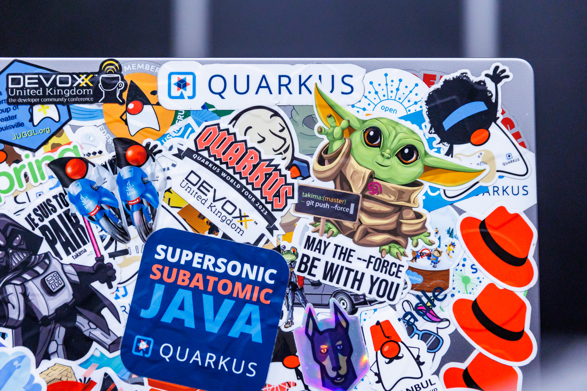

I'm a Java Champion and Senior Principal Developer Advocate at IBM (Red Hat), a well-known public speaker, open-source contributor, published author, and technical evangelist. I have more than 30 years of first-hand experience solving real-world enterprise problems in production environments using cloud-native technologies and agentic AI such as [Quarkus](https://quarkus.io/) and [Kubernetes](https://kubernetes.io/). 

I'm also responsible for [Java Champion](https://dev.java/community/jcs/), [Cloud Native Computing Foundation (CNCF) Technical Advisory Group Developer Experinece (TAG DevEx) chair](https://contribute.cncf.io/community/tags/developer-experience/)), [Cloud Native Computing Foundation (CNCF) ambassador](https://www.cncf.io/people/ambassadors/), [Microsoft MVP - Java and DevTools](https://mvp.microsoft.com/mvp), and [DevOps Institute ambassador](https://www.devopsinstitute.com/about-us/ambassadors/) to evangelize developers and operators in terms of developing cloud-native microservices, designing serverless functions, and deploying them to multi- and hybrid clouds in flexible, easy-to-use, cost-effective, open, and collaborative ways.

Find me here:
- Youtube: [@danieloh30](https://www.youtube.com/@danieloh30)
- X: [@danieloh30](https://twitter.com/danieloh30)
- LinkedIn: [daniel-oh-083818112](https://www.linkedin.com/in/daniel-oh-083818112/)
- Bluesky: [@danieloh30.bsky.social](https://bsky.app/profile/danieloh30.bsky.social)
